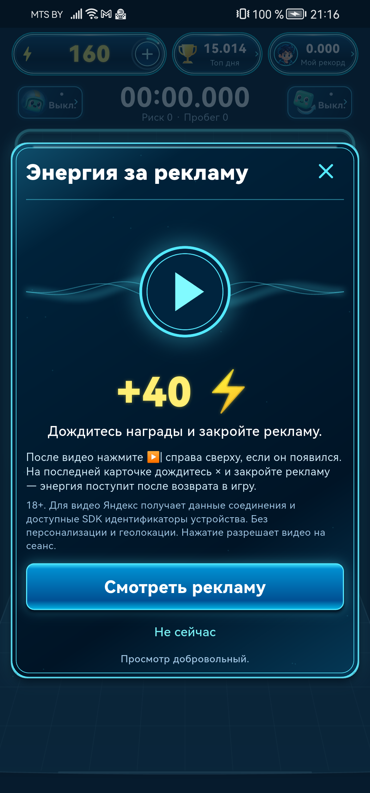

# Исправления замечаний Google Play — 18.10.2026

Обновлено: **21:59 Europe/Minsk**. Код пяти замечаний подготовлен и проверен. GP02 (полный доступ проверяющего к платным функциям) остаётся открытым. Новая Android-версия **1.0.183 (184)** **загружена в Google Play Alpha и сохранена**, preflightPASS; регистрация новой отправки/публикации пока не подтверждена. [Загрузка/ограничения](play184-upload.md). На основном телефоне остаётся Play-версия179.

| Замечание | Результат | Проверка / граница |
|---|---|---|
| GP01 — политика данных | Исправлено и опубликовано | Legal1.0.20: Supabase/Google/Yandex, реальные данные и удаление; два домена, HTTPS4/4 по SHA256 |
| GP02 — доступ проверяющего | Не завершено | Гостевой путь открыт; нет отдельного проверенного Google-профиля со всеми платными преимуществами без оплаты. Личный аккаунт не использован. EN-инструкция подготовлена; Console пока не исправлена |
| GP03 — публичные имена | Код/сервер/админка готовы; Android ждёт доставки | Правила перед публикацией имени, жалоба, собственное скрытие/возврат, административное скрытие/восстановление. Балансы, игровые возможности, места и результаты сохраняются. Новый путь действует в184; старые179 не отключены, принятие правил им не приписывается |
| GP04 — объяснение рекламы | Готово в184, проверено на Huawei | Из главного окна энергии инструкция убрана. «Смотреть» открывает промежуточное окно; отдельная «Смотреть рекламу» вызывает SDK. Яндекс/120сек/20наград сохранены |
| GP05 — Data safety/Auth | Исправление сохранено в Console | Supabase guest + optional Google OAuth; есть подтверждение сохранения. Отправка/публикация новой декларации не подтверждена |
| GP06 — сроки хранения | Исправлено и опубликовано | Auth audit30дней, закрытый support90дней, жалобы90дней и ближайшая ежедневная очистка; ручные копии30дней. Cron03:20Минск; лишних прав браузеру не добавлено |

## Реклама и первый вход

Подсказка закрытия: после видео использовать ▶|, если SDK его показал, затем дождаться × на последней карточке. Игра не перекрывает кнопки Яндекса и не закрывает рекламу до сигнала сети. Дефект собственного трёхминутного ожидания исправлен: пока нативная реклама открыта, поздняя награда не теряется. На Huawei настоящий demoSDK: подтверждён сеанс198.317сек, +40одинраз; следующий просмотр120→160. В QA185 повторно проверены чистое окно энергии, промежуточная инструкция и отсутствие запуска SDK от первого клика. Повторный рекламный просмотр в185 не нужен: код пути тот же, после183 менялись имена и область окна результата.

При первом запуске показывается вопрос18+/до18, затем необязательное предложение Google. Пропуск/отмена оставляет гостя. Возраст остаётся на устройстве; разрешение на рекламные данные отдельно. Нативный chooser/отмена/повторный запуск проверены на телефоне; личный аккаунт не выбирался.

## Проверки

- Полная Flutter-серия: **1015PASS /16SKIP /0FAIL**, concurrency1. После последнего изменения области окна результата — **28целевых PASS**. Analyze10файлов + последние2файла — чистый.
- Сервер: **100PASS**, повтор миграции/модерации2PASS; админка2PASS и Vite buildPASS.
- CloudQA: настоящие запросы rules/report/dedup/hide/reset; другому игроку скрытие не передаётся; рейтинг/метрики сохранены. Неадмину support HTTP403. Администраторские hide/idempotent/restore проверены существующим operator против рабочейБД; authenticated admin HTTP end-to-end не выдаём за проверенный.
- Remote Edge содержимое изменённых6модулей совпало с локальным1:1: android-api16/support-admin7. Миграция20261018175715 применена. Cleanup0/0/0, cron сохранён.
- HuaweiQA185: настоящие правила перед сохранением имени, жалоба с причинойother, маскировка имени при прежних#4/0.001с. Сервер подтвердил сохранённые правила/жалобу/собственный список; энергия160/попыток0 до игровой проверки. Отдельный тестовый target удалён, ссылка из скрытого списка очищена; два облачных tagged QA также удалены.
- Настоящая игра на QA185: **2.228с /5шагов**, сервер принял результат, энергия**160→159**, ровно1игра. QA и основной пакет остановлены, USBstayawake2 сохранён. Основной Play179 не удалялся/не очищался.
- Advisor не показал новых замечаний схемы. Прежние cron-предупреждения остаются при отсутствии USAGE для anon/authenticated; защита утёкших паролей выключена, парольный вход приложением не используется. Новые роли/гранты не создавались.

Физическая проверка нашла проблему, пропущенную первой widget-проверкой: окно результата выбирало внешний navigator и теряло профиль, поэтому кнопка жалобы отсутствовала. Исправлено `useRootNavigator:false`; регрессия теперь воспроизводит вложенный Android startup/game navigator. **AAB183/QA184 устарели; не публиковать.**

## Артефакт для Google Play

[Untouch1.0.183+184.aab](../../../releases/android-v1.0.183_20261018_181552_525/Untouch-1.0.183+184.aab)

SHA256 `b278623ca5f15fc4290c9b518fcbcb6ec731ee4841f5d87586647839e79a1ef6`. Release-key совпадает с прежней179, JAR подпись/ZIP CRC/64bitELF16KiB/targetSDK36/permissions PASS. Ресурс `string/app_name` в самом AAB = **untouch**, номера в названии нет. LiveYandex publisher units, GoogleBilling, serverwallet включены; free-test-grants/debug/demoAds в production выключены.

Сам AAB не устанавливался на телефон. На физическом устройстве проверен тот же Dart-код отдельным debug-signed release QA185 с demoYandex; это не заменяет установку через Play App Signing и проверку боевой покупки. Основная179 подписана Google, поэтому USB-обновление upload-key отвергается; удалять её ради установки нельзя.

Legal1.0.20 опубликован с проверенным FTPSbackup и FirebaseHosting. Админка опубликована, её index/JS совпали с dist, публичный вход ограничивает доступ к жалобам. [Privacy](https://untouch.fun/privacy/), [удаление](https://untouch.fun/delete-account/), [админка](https://untouch-admin-game-box-b30d4.web.app/).

## Осталось

1. Подготовить отдельный reusable review Google-профиль и полный бесплатный доступ к платным преимуществам; проверить из чистой установки и сохранить правдивый App access. [Подготовленная инструкция и границы](app-access-prepared.md). Пустой Google-аккаунт сам по себе доступа к подписке не даёт.
2. Подтвердить регистрацию отправки уже загруженной **184** в существующий Alpha; версия/дата в release notes/full description сохранены, GP05 включён в6pendingизменений. Сохранить полный App access и проверить финальную отправку. Новые short descriptions из другого чата не затирать. Chrome восстановлен новой вкладкой:184 принят/release11 сохранён/EN-RU дата и версия проверены/preflightPASS. Финальные подтверждения Send пока не зарегистрировали новую заявку;6изменений остаются pending. Это наблюдение UI, не доказанный отказ по правилам. [Подробности/восстановление телефона](play184-upload.md).
3. После доставки184 проверить установленную Play-версию/рекламу и покупку только в license-test режиме, без реального списания. Поддержке Google не писали, Git push не выполняли.

## Доказательства

[1015Flutter](block3-full-flutter-final.log), [28после navigator](block3-nested-navigator-retest.log), [100server](block3-full-server-final.log), [cloudQA](block3-cloud.log), [физическая модерация](phone185/result.json), [игра](phone185/game-result.json), [реклама198сек](phone182/result.json), [реклама120→160](phone183/result.json), [HTTPSlegal](legal20-https.json), [HTTPSadmin](admin-https.json), [AAB184](final184-aab-verification.json), [название184](final184-aab-label.json), [сертификат](final184-aab-certificate.json), [GP05сохранён](gp05-saved.png).

Навыки: session-memory — план/передача; Supabase/Postgres — миграция, доступ и облачная проверка; computer-use — проверка Console/админки.
