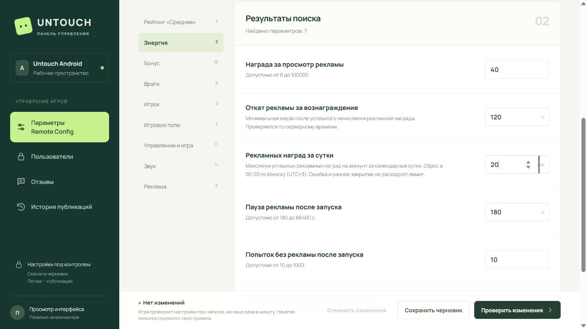

# Рекламные ограничения — Android 177 / RC51

Обновлено: 18.10.2026 15:09 Europe/Minsk. **Готово, доставлено и проверено.**

Установлены максимум **20 полученных рекламных наград на аккаунт в сутки** и **откат 120 секунд** между начислениями. Сброс — в 00:00 по Минску (UTC+3), по серверному времени. Награда осталась 40 энергии. Ошибки загрузки, раннее закрытие и повторная доставка одной операции квоту не расходуют.

Версия **1.0.176+177** установлена на Huawei поверх 176 без удаления приложения и очистки данных. Основная игра показывает «Сегодня: 3 из 20»; баланс сохранился — 969. Экран аккаунта и главный экран до/после установки совпали. Новых игр, результатов и рекламных начислений во время этой задачи не было. Основная и тестовые игры остановлены, USB-бодрствование 2 сохранено.

## Настройки

[Админка](https://untouch-admin-game-box-b30d4.web.app/) → **Параметры Remote Config → Бонус**, либо поиск «реклам».

| Поле | Значение | Путь внутри android_config_v1.config |
|---|---|---|
| Откат рекламы за вознаграждение | 120 секунд | `economy.androidEnergyV2.simpleBonus.videoCooldownSec` |
| Рекламных наград за сутки | 20 | `economy.androidEnergyV2.simpleBonus.videoDailyLimit` |

Опубликована **RC51**. Новое поле — только дневной лимит; откат 120 секунд уже находился в RC и получил понятное название и пояснение в админке. Допустимы целые значения: 1–86400 секунд и 1–1000 наград. Работают предварительный просмотр, подтверждение публикации, аудит и защита от перезаписи чужих изменений. Остальные настройки, условия и ключи RC сохранены. Верхний `watchAdCooldownSec` остаётся производным, отдельного независимого редактора для него нет.

Снимок — локальная проверка опубликованной сборки формы. По HTTPS подтверждено совпадение Hosting JS с собранным файлом: [сверка](admin-hosting-verification.json). Действующие значения RC проверены отдельно: [публикация](rc-published.txt). Тестовые значения 21 и 150 в браузерной проверке не публиковались.

## Как действует защита

Сервер проверяет квоту перед разрешением показа и при начислении. Счётчик и энергия изменяются одной транзакцией: параллельные запросы не выдают 21-ю награду. Счётчик находится в приватной записи игрока; клиент не выбирает его значение. Профиль возвращает использованное количество, предел и время сброса. Часы телефона не определяют серверный день; интерфейс использует привязанные серверные часы.

Уже выданные сегодня награды пересчитаны по журналу подтверждённых операций, включая старый формат `watch_ad`: у двух профилей получилось 0 и 3. Балансы не менялись. Повторная инициализация не уменьшает учтённый счётчик. Старые конфигурации без нового поля принимаются с пределом 20. Изменение RC сохраняет сегодняшнее количество, а новый предел и откат применяются сервером к следующим проверкам.

На 20-й награде основная кнопка показывает «До завтра» и отключается. На отдельной странице — «Лимит на сегодня». Это ограничение на аккаунт: оно не доказывает подлинность приложения или просмотра и не исключает создание новых аккаунтов. Play Integrity не внедрялся. Сеть Yandex, режим DemoAds, возраст 18+, награда 40 и прежний путь показа сохранены.

## Проверки и доставка

| Проверка | Результат |
|---|---|
| Полный Flutter с DemoAds | **1024 PASS / 2 SKIP / 0 FAIL** — [лог](flutter-full.txt) |
| Целевые клиентские проверки | 32 PASS: квота, серверные часы, RC, потеря ответа и награды — [лог](client-tests.txt) |
| Полный сервер | **97 PASS / 0 FAIL** — [лог](server-tests.txt) |
| Квота и форма | 9 PASS: 20/21, повторы, полночь, параллельные последние слоты, изменение RC, старые конфигурации, диапазоны — [лог](quota-tests-r2.txt) |
| Анализ кода | lib/test/SDK-probe без замечаний — [лог](analyze.txt) |
| Браузер | Значения 20/120, отказ на 0, предварительный просмотр двух изменений — [результат](admin-ui.json) |
| Рабочая БД, служебная роль приложения | 20 начислений по 40, отказ на 21-е, повторы и полночь; все тестовые записи откачены, Auth-пользователь не создавался — [результат](sql-canary.txt) |
| Физический profile QA | Huawei: состояния 0 и 19 разрешены, 20 запрещено; нажатие при лимите не отправляет запрос начисления, ошибок нет — [результат](phone/result.json) |
| Основная release-версия 177 | Установка поверх 176, сохранность аккаунта/главного экрана, 969 энергии и «3 из 20» — [результат](main-acceptance.json) |
| APK | Прежний сертификат, V2, CRC, ZIP16KiB, 8 библиотек native64, OAuth — [проверка](apk-verification.json) |
| Очистка после ревью | 12 исключений ресурсов и изоляция legacy сохранены — [проверка](apk-cleanup.json) |
| Данные | 2 профиля, 37 результатов, 0 новых операций/игр; энергия и защищённые данные прежние, добавлены проверенные счётчики 0/3 — [сверка](data-final.txt) |
| API | android-api v14 и remote-config-admin v13; 4 загруженных исходных файла совпали с локальными, запрос без авторизации возвращает 401 — [проверка](server-verification.json) |
| Телефон | Игры остановлены, USB2 — [проверка](device-final.json) |

При первом серверном прогоне обновлены два ожидаемо изменившихся контракта: число полей 124→125 и список межъязыковых примеров. Отдельный тест старой конфигурации выявил обязательность нового поля в общем валидаторе; добавлена совместимость только для отсутствующего `videoDailyLimit`. Повторные 9 и 97 проверок прошли. Из нового snapshot пересозданы 256 тестовых физических траекторий; сама физика не менялась. Первый физический HTTP-тест оборвался, поскольку обновление QA-пакета ещё выполнялось; повтор после завершения установки прошёл.

Доставлены API, админка, RC51 и APK. Код — `0d47958`; checkpoint — `8901b1e`, предыдущая принятая версия — `0037d54`. До доставки сохранены зашифрованные снимки БД/игроков/RC и ZIP исходников 176. Секреты и кадры основного профиля не включены в Git.

[APK 1.0.176+177](../../../releases/android-v1.0.176_20261018_120038_266/Untouch-1.0.176+177.apk): 86,953,836 байт, SHA256 `06e56c17164aac92a585c51422e2980c8fe5a6a6ecb353aaaf80e03995dc710c`. [Контрольные суммы 11 исходников](source-sha256.json). [План и журнал](../../../memory/tasks/2026-10-18-rewarded-daily-limit.md).

Реальный SDK с просмотром проверялся на версии 176; в 177 проверены новые ограничения и сохранность приложения. Публикации в Play, FTP, Telegram, git push, настоящих оплат и включения коммерческих объявлений не было.

Навыки: session-memory — план и сохранение результатов; Supabase — сервер, публикация и проверка данных. Форма проверена через CUA.
